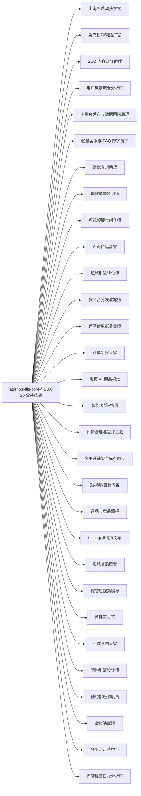

# 依赖关系图

## 复用度最高的公共技能

| 技能 | 复用员工数 | 使用方 |
|---|---|---|
| `简报生成` | 10 | `de-creator-brand-deal-manager`、`de-ecommerce-customer-service-assistant`、`de-ecommerce-multichannel-operator`、`de-ecommerce-product-scout`、`de-ecommerce-review-guardian`、`de-ecommerce-shortvideo-producer`、`de-indie-coldstart-growth-officer`、`de-indie-feedback-analyst`、`de-indie-launch-day-commander`、`de-local-store-daily-report-analyst` |
| `平台合规词扫描` | 6 | `de-creator-multichannel-rewriter`、`de-creator-script-writer`、`de-ecommerce-listing-copywriter`、`de-ecommerce-repurchase-operator`、`de-ecommerce-visual-designer`、`de-local-review-firefighter` |
| `平台格式适配` | 6 | `de-creator-multichannel-rewriter`、`de-indie-coldstart-growth-officer`、`de-indie-launch-day-commander`、`de-indie-multichannel-publisher`、`de-local-multichannel-ops-hub`、`de-local-store-video-director` |
| `定时排期` | 6 | `de-creator-multichannel-rewriter`、`de-indie-coldstart-growth-officer`、`de-indie-finance-tax-assistant`、`de-indie-launch-day-commander`、`de-indie-multichannel-publisher`、`de-local-member-awakener` |
| `评论情绪识别` | 5 | `de-creator-comment-operator`、`de-ecommerce-customer-service-assistant`、`de-ecommerce-review-guardian`、`de-indie-feedback-analyst`、`de-indie-launch-day-commander` |
| `归因分析` | 4 | `de-creator-data-reviewer`、`de-creator-private-traffic-converter`、`de-ecommerce-shortvideo-producer`、`de-indie-multichannel-publisher` |
| `标题生成` | 4 | `de-creator-multichannel-rewriter`、`de-creator-topic-planner`、`de-ecommerce-multichannel-operator`、`de-indie-coldstart-growth-officer` |
| `差评安抚话术` | 3 | `de-ecommerce-review-guardian`、`de-indie-light-cs-faq`、`de-local-review-firefighter` |
| `文档问答（RAG）` | 3 | `de-ecommerce-customer-service-assistant`、`de-ecommerce-review-guardian`、`de-indie-light-cs-faq` |
| `多语言写作` | 3 | `de-indie-launch-day-commander`、`de-indie-light-cs-faq`、`de-indie-seo-content-assistant` |
| `回复话术生成` | 3 | `de-creator-comment-operator`、`de-indie-launch-day-commander`、`de-local-review-firefighter` |
| `脚本结构生成` | 3 | `de-creator-script-writer`、`de-ecommerce-shortvideo-producer`、`de-local-store-video-director` |

## 员工 → core 依赖清单

| 员工 | 公共技能数 | spec 依赖数 |
|---|---|---|
| `de-indie-coldstart-growth-officer` | 4 | 0 |
| `de-indie-launch-day-commander` | 6 | 0 |
| `de-indie-seo-content-assistant` | 1 | 0 |
| `de-indie-feedback-analyst` | 2 | 1 |
| `de-indie-multichannel-publisher` | 3 | 1 |
| `de-indie-light-cs-faq` | 3 | 0 |
| `de-indie-finance-tax-assistant` | 1 | 0 |
| `de-creator-topic-planner` | 4 | 0 |
| `de-creator-script-writer` | 5 | 0 |
| `de-creator-comment-operator` | 6 | 0 |
| `de-creator-private-traffic-converter` | 7 | 0 |
| `de-creator-multichannel-rewriter` | 5 | 0 |
| `de-creator-data-reviewer` | 4 | 0 |
| `de-creator-brand-deal-manager` | 3 | 0 |
| `de-ecommerce-visual-designer` | 3 | 0 |
| `de-ecommerce-customer-service-assistant` | 3 | 0 |
| `de-ecommerce-review-guardian` | 4 | 0 |
| `de-ecommerce-multichannel-operator` | 3 | 0 |
| `de-ecommerce-shortvideo-producer` | 4 | 0 |
| `de-ecommerce-product-scout` | 2 | 1 |
| `de-ecommerce-listing-copywriter` | 2 | 0 |
| `de-ecommerce-repurchase-operator` | 2 | 0 |
| `de-local-store-video-director` | 3 | 0 |
| `de-local-review-firefighter` | 3 | 0 |
| `de-local-private-repeat-buyer-manager` | 2 | 0 |
| `de-local-groupbuy-designer` | 1 | 1 |
| `de-local-booking-scheduler` | 0 | 0 |
| `de-local-member-awakener` | 3 | 0 |
| `de-local-multichannel-ops-hub` | 1 | 0 |
| `de-local-store-daily-report-analyst` | 1 | 1 |
